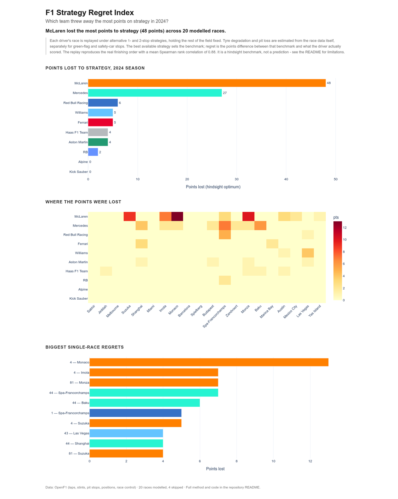

# F1 Strategy Regret Index

**Which team threw away the most points on strategy in 2024?**

Short answer: **McLaren — 48 points**, about 10% of everything they scored.
Mercedes were second with 27. But per point scored, the worst was **Williams**:
they left roughly 0.39 points on the table for every point they actually earned.

The interesting part is *how* the points went missing. Splitting the regret by
the type of mistake shows the wrong **number** of stops cost almost exactly as
much as the wrong **timing**:

| Error type | Driver-races | Points lost |
|---|---:|---:|
| Stopped too many times | 61 | 43 |
| Right stop count, wrong window | 133 | 42 |
| Stopped too few times | 10 | 16 |

That is the finding I would defend in an interview: teams obsess over the pit
window, but choosing the wrong stop count was just as expensive.



*Generated by `make dashboard` from the DuckDB outputs —
[open the interactive version](https://iamalphy.github.io/f1-strategy-regret/dashboard/).*

---

## The headline table

| Team | Points lost | Points scored | Lost per point scored |
|---|---:|---:|---:|
| McLaren | 48 | 497 | 0.097 |
| Mercedes | 27 | 346 | 0.078 |
| Red Bull Racing | 6 | 389 | 0.015 |
| Ferrari | 5 | 500 | 0.010 |
| Williams | 5 | 13 | **0.385** |
| Aston Martin | 4 | 56 | 0.071 |
| Haas | 4 | 24 | 0.167 |
| RB | 2 | 10 | 0.200 |
| Alpine | 0 | 10 | 0.000 |
| Kick Sauber | 0 | 0 | — |

Two rankings are shown on purpose. Absolute points lost rewards teams that
scored a lot in the first place; normalising by points scored shows that a
backmarker's bad call is proportionally far more costly.

### The five biggest single-race regrets

| Race | Driver | Actual | Model's best | Points lost |
|---|---|---|---:|---:|
| Monaco | Lando Norris | one set of hards, 78 laps | 2 stops (laps 28, 48) | 13 |
| Monza | Oscar Piastri | 2 stops | 1 stop (lap 23) | 7 |
| Spa | Lewis Hamilton | 2 stops | 1 stop (lap 15) | 7 |
| Imola | Lando Norris | 1 stop (lap 22) | 1 stop (lap 29) | 7 |
| Baku | Lewis Hamilton | 1 stop (lap 12) | 1 stop (lap 31, softs) | 6 |

---

## How the number is calculated

For every driver in every race:

1. **Clean the laps.** Drop pit-in and pit-out laps, lap 1, laps under a
   safety car / VSC / red flag, and laps more than 7% off the driver's own
   median (traffic, mistakes, debris).
2. **Fit a pace model.** `lap_time = intercept + driver + degradation(compound)
   × tyre_age + fuel × lap_number`. The fit explains the field to a mean RMSE of
   **0.61 s**.
3. **Measure pit loss from the data**, not from a constant. For each observed
   stop, pit-in lap plus pit-out lap is compared with the driver's clean pace.
   Stops under a safety car are costed against the pace of the cars that stayed
   out, then converted to green-flag-equivalent seconds. Median green-flag loss
   across the season: **~24 s**.
4. **Search strategies with a dynamic programme.** For each driver, find the
   cheapest feasible strategy over stint boundaries, subject to:
   - the two-compound rule,
   - the first stint staying on the compound the driver actually started on,
   - no stint longer than the longest stint any team ran in that race,
   - at least one stop.
5. **Score the regret.** Re-rank the field by each driver's real race time minus
   the seconds the optimal strategy would have saved. Points are the 25-18-15
   system with no fastest-lap bonus on either side, so a bonus point cannot
   create phantom regret.

### Validation (the part that makes the ranking credible)

The model never sees the finishing order when it is fitting pace; the order is
only used afterwards, as a test. Re-running each driver's **actual** strategy
must approximately reproduce the real classification:

| Check | Result |
|---|---|
| Mean Spearman rank correlation, modelled vs actual | **0.88** |
| Drivers placed within two positions of their real finish | **93.8%** |
| Mean pace-model RMSE | **0.61 s** |
| Races modelled | **20 of 24** |

`make verify` enforces these thresholds and exits non-zero if they are missed,
so a broken model cannot silently publish a ranking.

### Races excluded, and why

| Race | Reason |
|---|---|
| Montréal | 65% of laps on wet tyres — out of scope |
| Silverstone | 24% of laps on wet tyres |
| São Paulo | intermittent rain, no usable clean-lap sample |
| Lusail | source stint data corrupt (18 drivers show 1–2 lap mid-race stints) |

Excluding them is a choice, not an accident: a dry-tyre degradation model has
nothing honest to say about a wet race, and guessing at Qatar's stop counts
would have manufactured regret.

---

## Honest limitations

- **It is a hindsight benchmark, not a prediction.** The optimum is chosen with
  full knowledge of how the race unfolded.
- **One driver at a time.** Other drivers' races are held fixed, so second-order
  traffic effects and dirty air are not modelled. This makes the regret estimate
  optimistic in close fights.
- **No tyre-set accounting.** The model can propose a compound sequence a team
  might not have had fresh sets for.
- **Degradation is statistical.** A linear tyre-age term fitted per race, not a
  physical tyre model. Monaco's 13-point call is the most sensitive result to
  this assumption.
- **Pit loss is per race, not per team.**
- **The optimum is the model's optimum**, not a proven one.

---

## Reproduce it

Requires Docker only.

```bash
docker build -t f1-strategy-regret .

make data        # download and cache 24 race weekends (~20 min, rate limited)
make db          # build the DuckDB star schema
make model       # fit pace, search strategies, score regret
make dashboard   # render dashboard/index.html
make verify      # credibility gate
```

Open `dashboard/index.html` in a browser. The full pipeline is deterministic
given the cached data.

### Data source

[OpenF1](https://openf1.org) — free, no authentication, covers laps, stints,
pit stops, positions, race control and weather for 2024. The API allows 3
requests per second, so `extract.py` throttles and caches every response;
re-runs are offline and free.

FastF1 was tried first and abandoned: its timing endpoints now require an F1
account login, and without credentials the lap data comes back empty.

Formula 1 data is fetched from the public OpenF1 API. No Formula 1 trademarks or
copyrighted race footage are redistributed here.

---

## Repository layout

```
pipeline/
  extract.py       throttled, resumable OpenF1 downloader
  build_db.py      star schema, caution periods, pit-cycle loss, integrity checks
  model.py         pace fit, dynamic-programme strategy search, regret scoring
  dashboard.py     static Plotly page
  run_sql.py       runs sql/queries.sql, writes data/processed/sql_results.md
  verify.py        credibility gate (non-zero exit on failure)
sql/
  queries.sql      the published tables, in SQL
dashboard/
  index.html       generated, committed so GitHub Pages can serve it
docs/
  powerbi-rebuild.md   chart-by-chart Power BI mapping (DAX included)
```

The analytical layer is SQL over a DuckDB star schema (`fact_laps`,
`fact_stints`, `fact_pit_cycles`, `fact_results`, `dim_races`, `dim_drivers`).
Python orchestrates and does the optimisation.

## Power BI

The published dashboard is Plotly because a `.pbix` cannot be opened from
GitHub. `docs/powerbi-rebuild.md` maps every chart to its Power BI visual, with
the DAX measures and the data model, so the same report can be rebuilt on
Windows and screenshotted as a Power BI artifact.

## Data

Raw JSON and the DuckDB file are not committed. They are reproducible from
`make data` and are large enough that committing them would be noise.
Aggregated results (`data/processed/*.csv`, `validation.json`) are regenerated
by the pipeline; `sql_results.md` is committed as the published table set.
